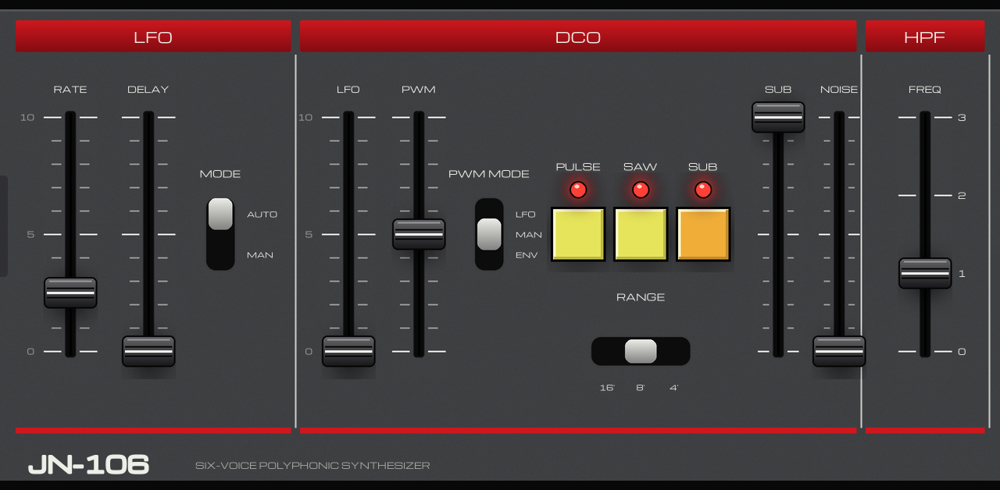

# JN-106 for MPC

A six-voice polyphonic Juno-style synth plugin for Akai MPC OS standalone devices (MPC Live/One/X/Key, Force): the DSP of
[Ultramaster KR-106](https://github.com/kayrockscreenprinting/ultramaster_kr106) by Karl LaRocca, on a realistic panel skin
drawn for the MPC screen, with its 256 factory presets (128 Juno-60 and 128 Juno-106 patches) as native presets.

**Status:** loads, plays and loads presets on a Force (MPC OS 3.9.1, armv7). The aarch64 build (Gen2 MPCs) has not
been run on a device. CPU on the Force (`tools/bench.sh`, six held notes): 2x oversampling about 31% of a block (WARN),
1x about 20%; a fast Q-Link sweep peaks near 47% at p99 (FAIL class). Use 1x on a busy project.

## Screens
LFO / DCO / HPF, FILTER / AMP / ENV (with chorus), ARP (with TRANS and HOLD), PERFORM (volume, portamento, bender depths,
tuning) and SETTINGS (VCF oversampling 1x/2x, wavetable or PolyBLEP oscillators, ignore velocity, arp limit, mono
retrigger). The keybed and scope are left out. Each screen except SETTINGS has its own Q-Link page.

## Presets
All 256 factory presets are in the instruments browser (Sounds > Instruments > JN-106) and in MPC's PRESET list
(`vst/presets.json`). A preset sets the patch and the model (JUNO-60 or 106 mode: bank A is the 60 mode); live controls
(arpeggiator, hold, portamento, tuning, volume, bender depths) stay as they are. Names are upstream's; one is cut to 23
characters by the wrapper. The PRESET dropdown in the plugin header does not open on the Force; use the browser.

## How faithful is it?
The engine is upstream's, and it is built to follow the hardware rather than a generic "analog synth" recipe. All of this
comes from the vendored source's own comments and tables; it has not been re-verified here against a real Juno.

**Circuit-modelled (upstream)**
- **Filter:** a four-pole cascade modelling the IR3109, with per-stage OTA `tanh` saturation, resonance feedback fitted to
  measured slopes, thermal noise from the BA662/IR3109 bias current, and the IR3109's exponential converter (including its
  saturation above 20 kHz) in the cutoff path. The 6 and 106 have separate cutoff-CV front ends.
- **VCA:** the control law is the TR17 / 22K emitter circuit solved numerically (60 and 6), or a 56-point sweep measured on a
  106 (106 mode), so the fast release tails and the percussive low end of the envelope come out right.
- **Oscillators:** one phase accumulator drives saw, pulse and sub, as the single capacitor ramp does in the DCO, so their
  phase relationships are locked. Band-limited with 4th-order PolyBLEP, or from wavetables (SETTINGS). Waveform levels are
  calibrated from Juno-6 recordings (60 and 6) and a 106 calibration recording (106).
- **Chorus:** two MN3009 BBD lines with the MN3101 clock modulated by one LFO in antiphase, with BBD charge-transfer gain
  loss, anti-aliasing after Gabrielli, D'Angelo and Squartini (DAFx25), and the IC6 summing network for the mono and
  stereo jacks. Power-rail ripple is modelled too.
- **Noise and per-voice character:** the noise source and its CV circuit are modelled, and each voice carries small
  per-voice trims (filter frequency and width), as the real voice cards differ by a few cents.

**Hardware-matched (upstream)**
- **106 firmware:** the 106's control behaviour is reimplemented from a disassembly of its slave CPU (uPD7811G): one 4.2 ms
  main loop that updates envelopes, LFO, portamento and the filter, a 14-bit cutoff accumulator, integer-stepped LFO with
  the firmware's delay envelope and rate table, and the per-voice DAC write timing.
- **106 filter table:** cutoff per DAC code from a measured table (voice card V4), which captures the exponential converter's
  full shape.
- **Juno-6/60 envelopes** from the IR3R01 chip: attack and decay/release times fitted to hardware measurements.
- **Measured curves** for the 6's high-pass filter, and for the 106's sub level and noise.

## Checked against the service notes and schematics (this port)
Roland's Juno-106 and Juno-60 service notes and the Juno-6 schematic were read against the engine
(`src/VENDORED.md` has the details). What they confirmed, and what they changed:
- **Confirmed, no change:** 106 pulse-width range (50% to about 95%, the service-note calibration), the 4.2 ms control loop,
  chorus rates (I about 2 s per cycle, II about 1.2 s, I+II shallow and fast) and depth ratio, the high-pass filter
  switch positions, and the assumption of a calibrated, symmetric LFO trim on the 6 and 60.
- **106 DCO pitch (changed):** the oscillators are 8253 counters, so pitch is held between 4.2 ms control ticks and each
  note is rounded to a whole divider of the master clock (1, 2 or 4 MHz by range).
- **60 envelope sliders (changed):** the 60 reads plain 50K dividers where the 6 has a 39K pull-up across each slider, so the
  60's attack, decay and release now use their own taper instead of a copy of the 6's.
- **Not possible from the manuals:** the 60's oscillator LFO depth and sub level (the sub level is still a copy of the 6's
  taper, a placeholder upstream) depend on circuits the manuals don't give values for; they need measurements from a real 60.

## Changes to the upstream DSP
Listed in `src/VENDORED.md`. From the Roland service notes and schematics:
- 106 mode: the DCO pitch moves in 4.2 ms steps (the CPU's control loop) and each note is rounded to an 8253 counter
  value, so the top notes can sit a few cents off, as on the hardware.
- 60 mode: attack, decay and release use the 60's linear slider wiring instead of copying the Juno-6 taper (the Juno-6
  has a 39K pull-up across each slider). Both ends of each slider are unchanged; the middle is faster.

## MIDI
Notes, pitch bend, mod wheel (the LFO trigger), sustain pedal (HOLD), CC 120/123, and upstream's CC map (3, 5, 7, 9, 11-13, 70-82).
CC 20-35 and NRPN are the wrapper's (first page's Q-Links, any parameter). Master volume defaults to 0.3 (upstream's 0.5 clips).

## Install
Download the zip for your MPC from the releases page (armv7 for Gen1, aarch64 for Gen2) and follow its `INSTALL.md`, or
install it from the mpc-vst-plugins catalog. The installer restarts MPC.

## Build
`SKIN=real ./build.sh` (Docker; needs a checkout of https://github.com/sd88me/mpc-vst-plugins at `$MPC_VST`, default
`~/mpc-vst-plugins`): parameters, presets, skin art, `kr106.so` for armv7 and aarch64. `tools/test_port.sh vst/vst.json`
for the host test. Release: `docs/RELEASING.md` in mpc-vst-plugins, with
`--repo sd88me/mpc-vst-jn106 --license GPL-3.0-only --id j106`.

## Layout of this repo
`src/` vendored upstream (`src/VENDORED.md`), `vst/engine.cpp` the engine, `tools/gen_params.py` the parameter list,
`tools/presets.py` + `gen_presets.cpp` the presets, `skin/make_real_skin.py` the realistic skin (`skin/make_skin.py`, the
older skin cut from upstream's panel art, is kept but not shipped).

## Licence
GPL-3.0-only, as upstream. The skin contains no maker's name or logo. Michroma font: SIL OFL (`skin/assets/OFL-Michroma.txt`).
